# Historical figure gallery

**Data Provided by Zillow Group**

All sixteen images below are byte-identical saved PNG outputs from the shared-team final notebook. They were not freshly recomputed. Source cell/output coordinates are zero-based and can be checked against [the figure manifest](technical/figure_manifest.json). The two original ROI/income scenario figures are omitted.

Interpretation limits appear beside each figure. Original labels are preserved rather than silently redrawn.

## Figure 1: Top and bottom selected metros: home-value trends

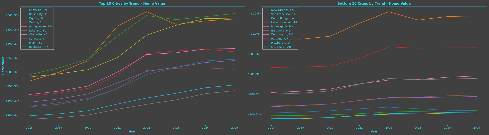

The selected groups follow the original average annual growth ranking. The values are ZHVI typical-home-value indices, not median sale prices. Rankings depend on the retained series, cleaning choices and partly observed calendar years; these are not current investment recommendations.

Source cell 32, output 0. *Data Provided by Zillow Group*

## Figure 2: Top and bottom selected metros: rent-index trends

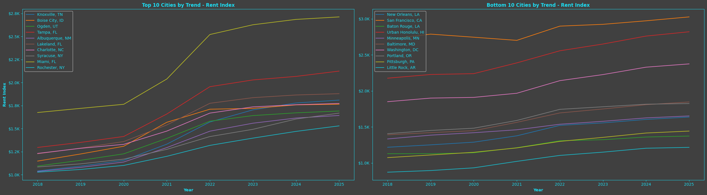

The same selected metro groups are shown using the rent index. ZORI concerns market asking rents; it does not establish rent collected or property-level rental income. No new trend calculation was performed for this publication.

Source cell 33, output 0. *Data Provided by Zillow Group*

## Figure 3: Top and bottom selected metros: sales-count trends

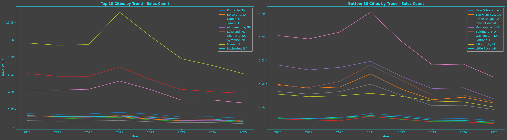

The intended plotted field is SalesCount. The original y-axis incorrectly says Home Value; values should be read as counts, not prices. The groups were selected using the home-value growth procedure, not an independent sales-growth ranking.

Source cell 34, output 0. *Data Provided by Zillow Group*

## Figure 4: Top and bottom selected metros: inventory trends

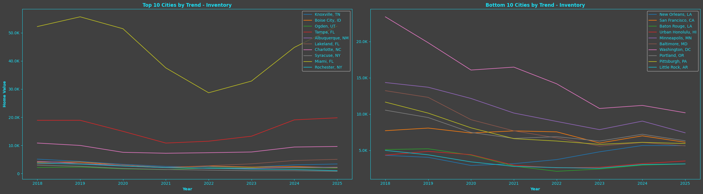

The intended plotted field is Inventory. The original y-axis incorrectly says Home Value. This saved view describes listings in the selected project snapshot; it is not a current ranking or a causal explanation of price changes.

Source cell 35, output 0. *Data Provided by Zillow Group*

## Figure 5: United States for-sale inventory

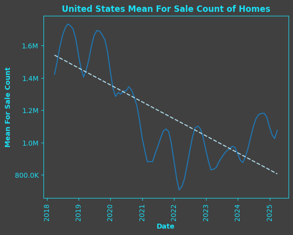

The source selects its United States inventory row. The original title includes the word Mean, but this is not a newly calculated mean across all metropolitan areas. The dashed line is a fitted historical trend, not a forward forecast.

Source cell 38, output 0. *Data Provided by Zillow Group*

## Figure 6: United States sales count; original chart title repeats the inventory title

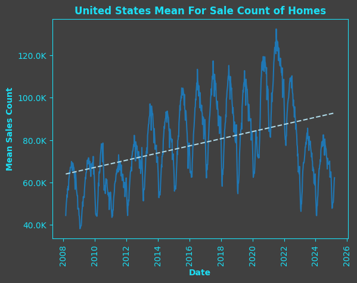

The source uses the separate weekly sales-count input and its United States row. The original title repeats the inventory-chart title; the y-axis and source field indicate sales count. The dashed fitted line is descriptive, not forecast validation.

Source cell 39, output 0. *Data Provided by Zillow Group*

## Figure 7: United States Median Sales Price of Homes

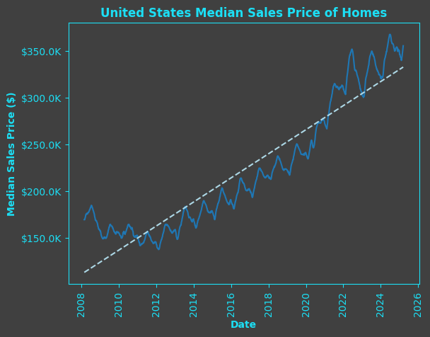

This uses the separate national median-sale-price input, not ZHVI. Transaction-price summaries and typical-home-value indices answer different questions. The saved series and fitted trend were not recomputed during publication.

Source cell 40, output 0. *Data Provided by Zillow Group*

## Figure 8: United States Mean Sales Price of Homes

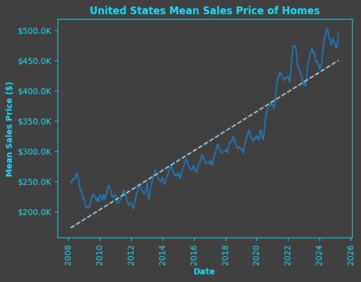

This uses the separate national mean-sale-price input. It should not be substituted for median sale price or typical home value. The dashed fitted line describes the historical snapshot rather than establishing future appreciation.

Source cell 41, output 0. *Data Provided by Zillow Group*

## Figure 9: United States Percent of Homes Sold Above Listing Price

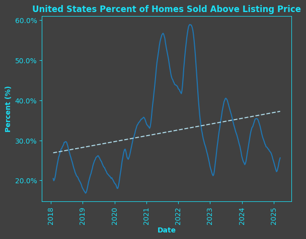

The source plots the saved national share series for sales above list price. It is distinct from sale-price levels. Historical fitted lines do not establish current buyer or seller conditions.

Source cell 42, output 0. *Data Provided by Zillow Group*

## Figure 10: United States Percent of Homes Sold Below Listing Price

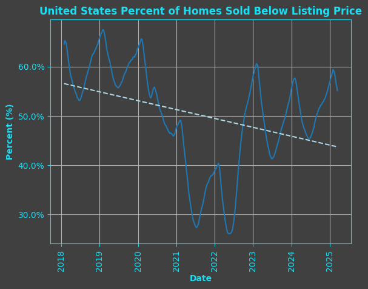

The source plots the saved national share series for sales below list price. These shares are not necessarily the exact complement of above-list shares because transactions at list price also exist. No current-market recommendation follows from this image.

Source cell 43, output 0. *Data Provided by Zillow Group*

## Figure 11: Index Rating Trends by State Over R12

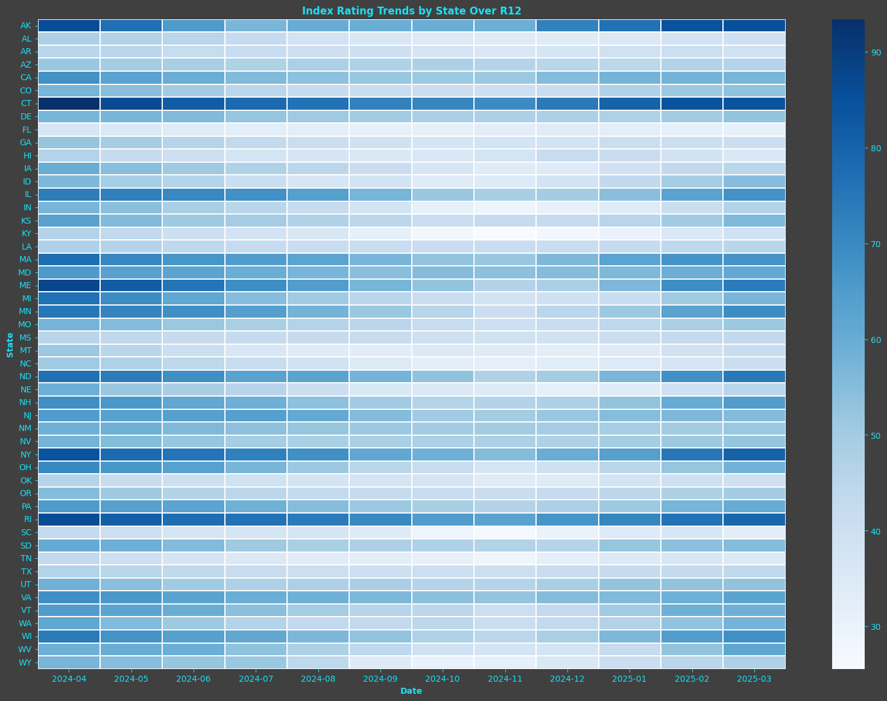

The retained code groups the available metro-index rows by state label and date and displays the final twelve columns. This state aggregation and its coverage are historical; the heatmap does not establish that buying in a particular state is advisable.

Source cell 46, output 0. *Data Provided by Zillow Group*

## Figure 12: Legacy time-on-market comparison; alignment and unit limitations

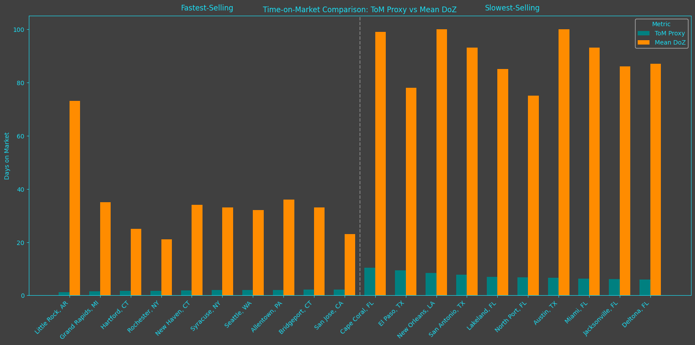

Known limitations apply. The original denominator comes from a separate long-form sales dataframe and aligns by row index rather than the merged region/date keys. The chart also compares an inventory/sales ratio with a days measure under a shared days label. Its fastest/slowest labels are not validated findings.

Source cell 49, output 0. *Data Provided by Zillow Group*

## Figure 13: Average Time-on-Market Proxy by State; legacy alignment limitation

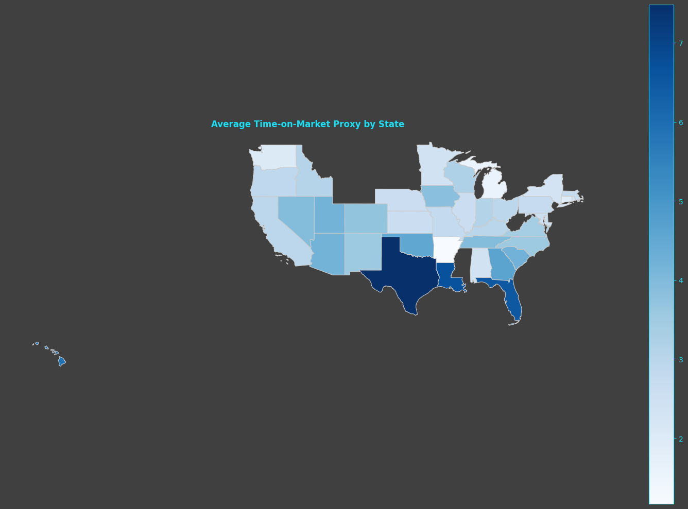

Known limitations apply. This saved map inherits the legacy denominator alignment and selected-record issues. The plotted ratio is not a number of days and does not independently measure how quickly a property sells or rents.

Source cell 49, output 1. *Data Provided by Zillow Group*

## Figure 14: Average Mean DoZ by State; legacy selection limitation

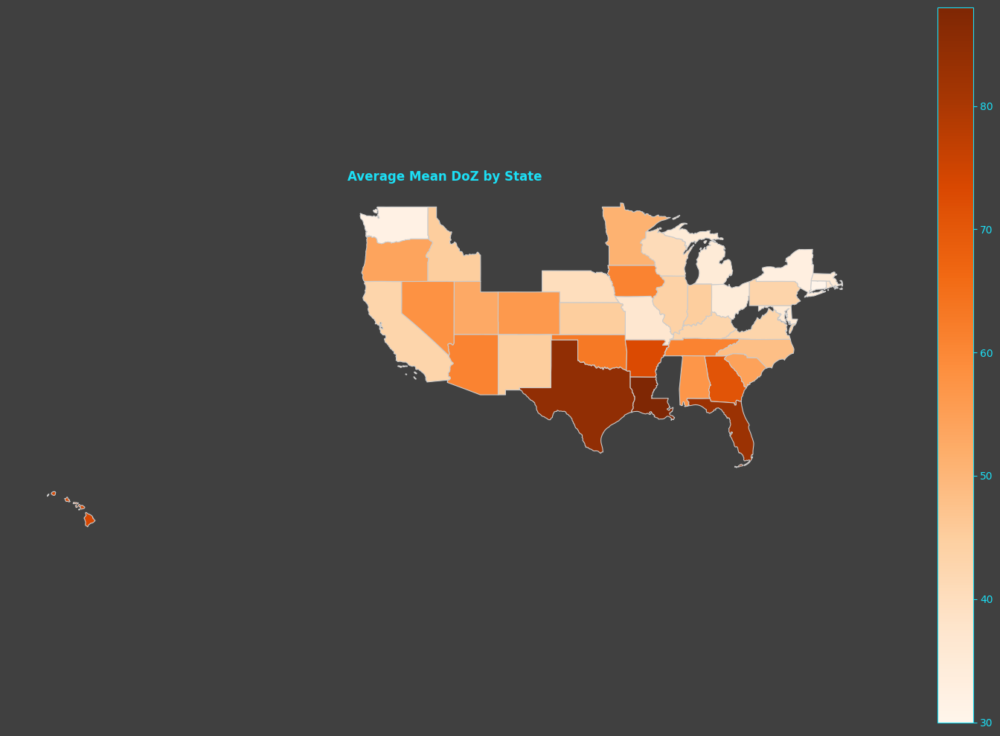

Known limitations apply. Although the pending-days series is a time measure, this saved map inherits the selection arising from the legacy market-duration processing. Pending duration is not the full period to closing or a measured rental duration.

Source cell 49, output 2. *Data Provided by Zillow Group*

## Figure 15: Historical actual-versus-predicted diagnostic from random row split

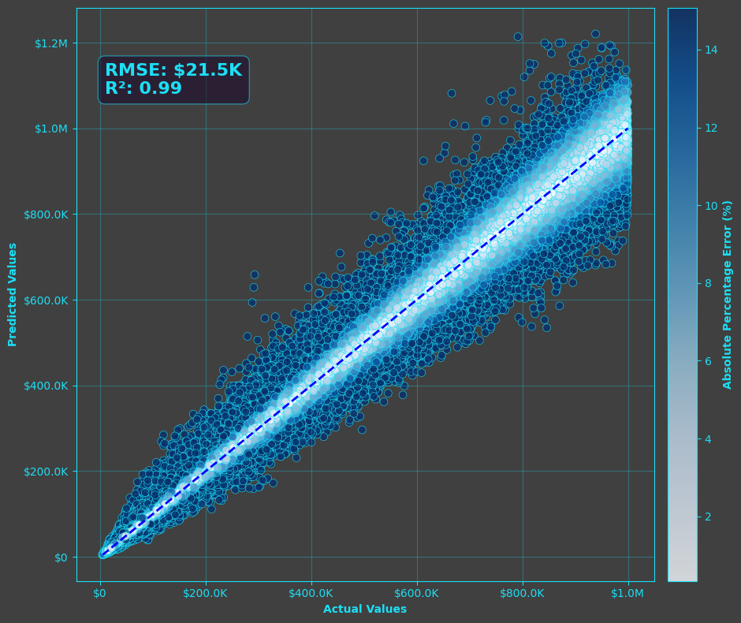

This is a saved diagnostic from the original random 80/20 row split across repeated neighborhoods and dates. The score annotation is not an independently validated prospective forecasting result. The 24-row future target is not guaranteed to represent 24 calendar months after filtering.

Source cell 59, output 0. *Data Provided by Zillow Group*

## Figure 16: Historical XGBoost feature importance

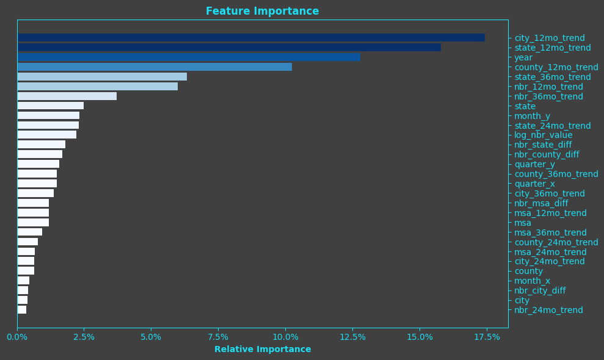

These are saved feature-importance values from the same historical random-split model. They are not causal effects or evidence of an independently validated forecast. Correlated geographic and lag features also limit interpretation.

Source cell 61, output 0. *Data Provided by Zillow Group*
