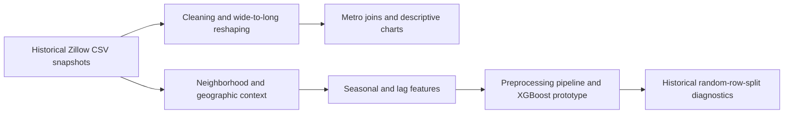
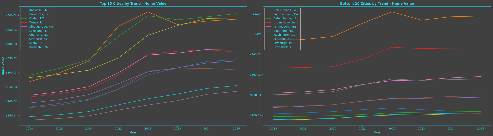
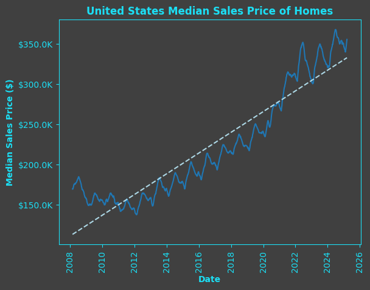
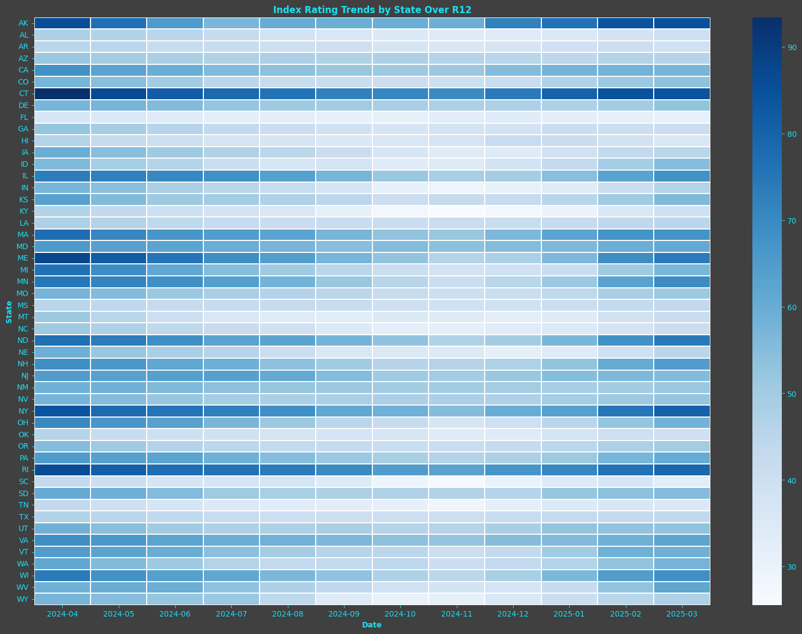

# Zillow Housing Market Analysis and Historical ML Prototype

Collaborative 2025 academic project by **Jake Holley, Miranda Dahl and Vansh
Verma**. The project combines housing-market exploration with a neighborhood
value modeling prototype using Python, Zillow Research series and geographic
context.

This repository documents the original academic analysis with reviewed notebook
source, historical figures and an explicit audit of reproduction and model-validation limits.

**Data Provided by Zillow Group**

## Review the work

- [All 16 historical figures and their captions](FIGURE_GALLERY.md)
- [Public notebook source](notebooks/zillow_home_value_analysis.ipynb)
- [Technical evidence and provenance](technical/TECHNICAL_EVIDENCE.md)
- [Input inventory and fingerprints](technical/input_inventory.json)
- [Methods and limitations](METHODS_AND_LIMITATIONS.md)
- [Data attribution and publication boundary](DATA_AND_USAGE.md)

## At a glance

| Area | Verified scope |
| --- | --- |
| Original notebook | 70 cells, 46 code cells and 18 saved PNG outputs |
| Public source copy | 65 cells, including 43 original code cells; outputs and execution counts removed |
| Published figures | 16 saved PNGs; profit and income scenario figures omitted |
| Input recovery | All 16 distinct required CSV filenames recovered privately; 15 distinct file hashes |
| Historical coverage | Different series span 2000-2025, 2008-2025, 2015-2025 or 2018-2025; retained snapshots end in March 2025 |
| Team | Three named collaborators; section labels are retained without claiming sole authorship |
| Runtime status | No notebook replay, model retraining or fresh figure generation during publication |

The original shared-team notebook is byte-identical to the retained local final
version. Its title, authors and named charts corroborate the project identified
in the course feedback. A Canvas attachment was not available to establish exact
submitted-file byte identity.

## Questions and workflow

The original project explored historical metro home values and rents, national
sale and inventory indicators, state market conditions, market-duration measures
and a neighborhood value model. The public copy omits the final unvalidated
profit/income recommendation sections.



The retained code demonstrates Pandas transformations and joins, NumPy feature
construction, Parquet output, Matplotlib/Seaborn charts, geographic plotting and
scikit-learn preprocessing around an XGBoost regressor. That source evidence is
separate from a successful fresh execution of the whole workflow.

## Selected historical views

### Metro home-value trends



These are saved comparisons under the original ranking and data-selection
procedure. The values are based on ZHVI, a typical-home-value index, not a median
transaction-price series. They do not establish current market rankings.

*Data Provided by Zillow Group*

### National median sale-price series



This figure uses the separate weekly median-sale-price input. Its metric differs
from ZHVI. The dashed line is a historical fitted trend, not a validated forecast.

*Data Provided by Zillow Group*

### State market-index heatmap



The saved heatmap summarizes the project's state-level aggregation for the
trailing twelve displayed months. It is historical descriptive evidence, not a
recommendation to buy in a particular state.

*Data Provided by Zillow Group*

The [complete gallery](FIGURE_GALLERY.md) also contains the national indicators,
legacy market-duration diagnostics and model/feature-importance figures. Their
specific limitations are placed beside each image.

## Model evidence and its limits

The source fits an XGBoost regressor inside a preprocessing pipeline with
categorical encoding, numeric imputation and scaling. Features include geographic
context, seasonal encodings, value differences and row-based lag trends. The
historical target is a future log-value difference.

The evaluation uses a **random 80/20 row split**, not a time-separated or spatial
holdout. A 24-row target shift is not guaranteed to equal 24 calendar months after
filtering. The saved model-score annotation is therefore not advertised as
validated forecasting accuracy. See [methods](METHODS_AND_LIMITATIONS.md).

## Run the publication checks

The two static audit helpers and their tests are **new November 2026 portfolio
tooling**, separate from the original 2025 team notebook. Python 3.10+ and its
standard library are sufficient for these checks:

```sh
PYTHONDONTWRITEBYTECODE=1 python3 -m unittest discover -s tests -v
python3 scripts/export_notebook_evidence.py /path/to/authorized/FINAL_NOTEBOOK.ipynb --output-dir /path/to/separate/export
python3 scripts/audit_inputs.py notebooks/zillow_home_value_analysis.ipynb --data-dir /path/to/authorized/csv_folder --output input_audit.json
```

The input audit reads CSV structure and hashes without executing notebook cells.
Running it on the public, edited notebook produces a different source-notebook
fingerprint from the retained original; that is expected.

[requirements-notebook.txt](requirements-notebook.txt) lists packages imported by
the original source. It is not an environment lock or proof of a working replay.

## Source and reuse boundary

Data sources: [Zillow Research Housing Data](https://www.zillow.com/research/data/),
[ZHVI methodology](https://www.zillow.com/research/zhvi-methodology/) and
[ZORI methodology](https://www.zillow.com/research/methodology-zori-repeat-rent/).
Raw provider CSVs, private shared-folder links, institutional branding and course
feedback are not published here. See [DATA_AND_USAGE.md](DATA_AND_USAGE.md).

## Next verification work

A fresh replay still needs an independently configured environment, the external
state-boundary files, corrected market-duration alignment and appropriate
time-based model validation. Recovering all CSV inputs alone does not establish
that those steps have passed.
